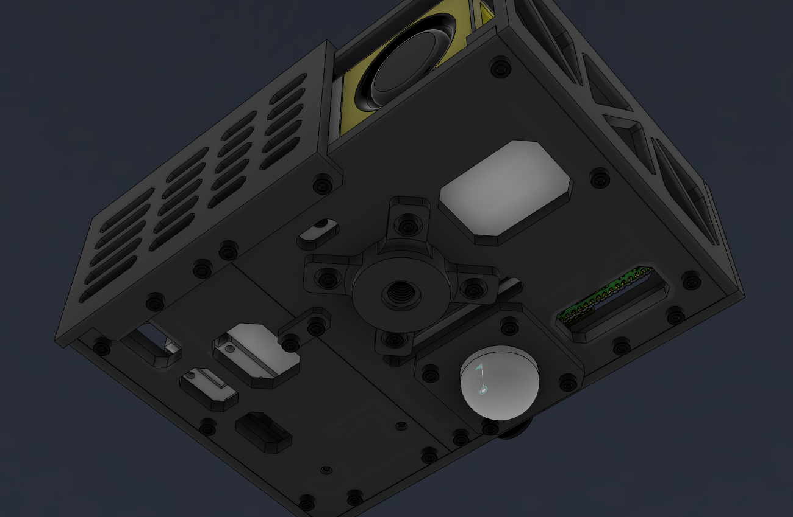
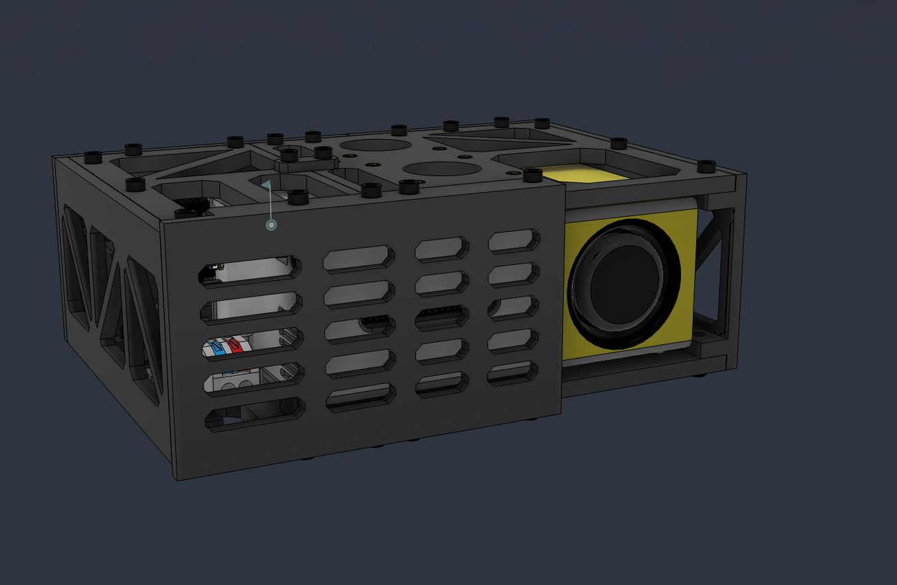
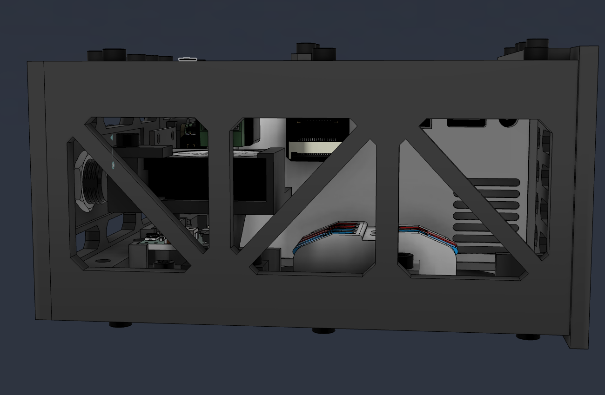
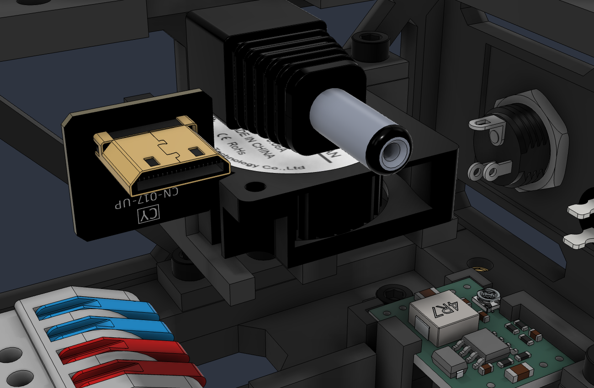
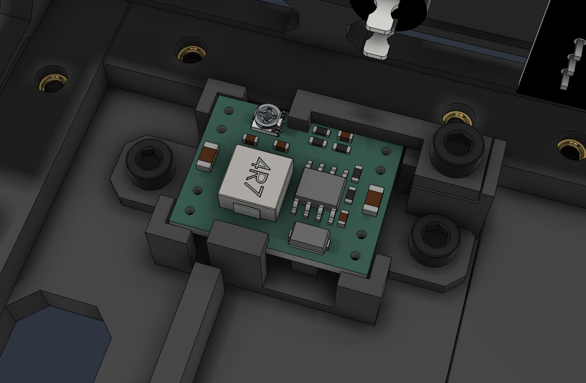
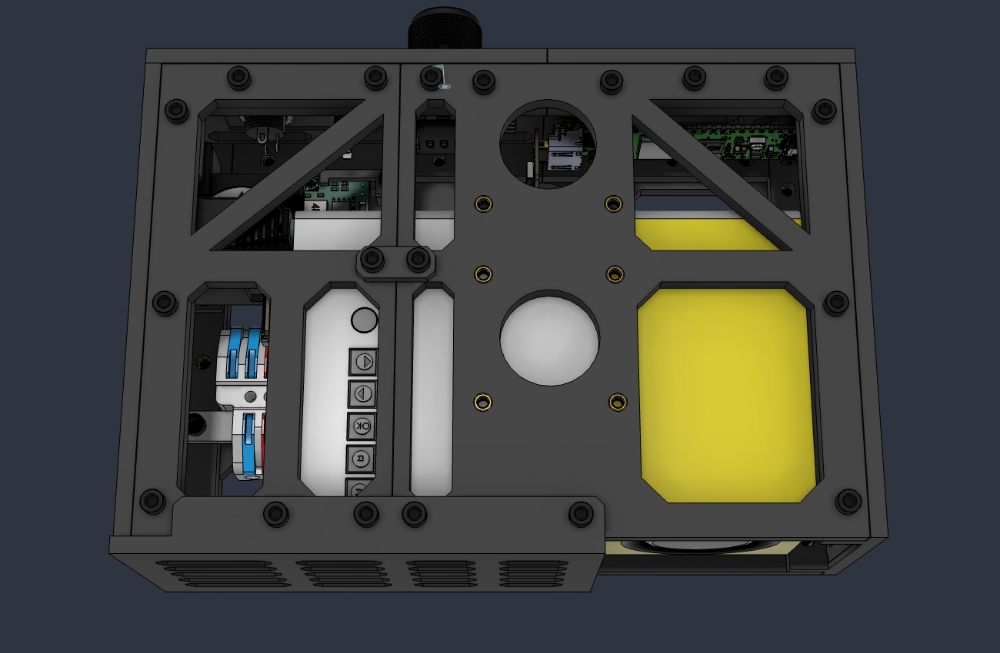

# Komorebi box cage: working notes

State and decisions for the printed open cage around the YG300 projector, the Pico and the controls.

The design rules are in [DESIGN_LANGUAGE.md](DESIGN_LANGUAGE.md). This file tracks what goes in, what is decided, and where the work stands.

Fusion files, in the project `AA`, folder `smartProjector / prototyping`:

- **`komorebi-box`:** the assembly. It links every bought part and the cage.
- **`komorebi-cage`:** the printed parts only. Built by [cad/build_cage.py](cad/build_cage.py).


More views are in [assets](assets): the underside with the seam strap and the two modules, the top, the bay without the top plate, the port end with its truss bays, the buck converter in its tray, the front with the grill, the blower under the DC plug.

---

## Steps

1. [x] **Read `komorebi-box` and measure the parts.** Done `2026-11-23`.
2. [x] **Decide the layout.** Done `2026-11-23`, with Saurabh: rear bay, with a top plate.
3. [x] **Rough cage, parts placed on it.** Done `2026-11-23`.
4. [x] **First review by Saurabh.** Done `2026-11-23`, see [Review, first round](#review-first-round).
5. [x] **Fastener holes cut, fasteners counted.** Done `2026-11-23`.
6. [x] **Second review: PLA, brim, split parts.** Done `2026-11-23`, see [Review, second round](#review-second-round). The fastener list changed with it, see [Fasteners](#fasteners).
7. [x] **Third review: front grill.** Done `2026-11-23`, see [Review, third round](#review-third-round) and [Front grill](#front-grill).
8. [x] **Fastener models placed.** Done `2026-11-23`. Saurabh brought six models into `komorebi-box`. 108 copies sit on their places, see [Fastener models](#fastener-models).
9. [x] **Sizes against the real projector, then the lips.** Done `2026-11-25`. The real projector did not fit front to back. The cage keeps its size, the lips changed, see [Projector stops](#projector-stops).
10. [x] **Fourth review, after the first prints.** Done `2026-11-25`: clamp bars, M2.5 for the Pico, the terminal block, truss side panels, the blower. See [Review, fourth round](#review-fourth-round).
11. [ ] **Print what changed.** The list is in [Print again](#print-again).
12. [ ] **Blower against the real heat sink.** Its place is a guess, see [Blower](#blower).
13. [ ] **Assembly notes.**

---

## Rules for this cage

From Saurabh on `2026-11-23`:

- **No case around it.** The cage is the enclosure, and it is open so the projector can breathe.
- **The lens looks out of the front.** The DC socket, the rotary encoder and the button sit on the opposite side.
- **The Pico and the DVI sock are one rigid block.** They are soldered pin to pin.
- **The two CY HDMI plugs and their ribbon are reused.** The ribbon is 30 cm or longer and is not modelled.
- **Wires are not planned yet.** Not between button, converter, encoder and light sensor either.
- **The light sensor has its own module.** It fits on the bottom or on the top.
- **The magic arm adapter fits on the bottom or on the top too.** The cage stands on a tripod or hangs from a ceiling. Its thread is printed and tested, it must point away from the cage.
- **Saurabh brings the fastener models in.** The holes get designed, the fasteners get counted, then the models get copied and placed.
- **Every part prints on the Prusa Mini bed,** 180 x 180 mm, with room for a brim around it.
- **It is printed in PLA, with a brim.** Without a brim the edges curl up.
- **The rear, the top and the floor are two parts each.** Small parts stay flat. The joint between the two is small but strong.
- **No chamfer on an edge that lies on the bed.**
- **The front gets a printed grill, but not in front of the lens.**
- **Enough room, not too much.** Tighter than the solar server cage.
- **The look follows Doscher.** Open trusses, octagon windows, screws that show.
- **No assembly documents yet.** Design first.

From Saurabh on `2026-11-25`, after the first prints:

- **M2 is too small for the Pico.** It is M2.5 now. He drills the holes in the Pico and in the DVI sock.
- **A board in a tray is held by a small clamp bar with one screw.** No snap arms.
- **The side panels are truss bays,** like the modular Doscher frames. No half cut window, no cut-out made for one plug, and not just an open frame. Both sides as close as possible.
- **The cage keeps its size.** The front grill stops the projector at the front.
- **A blower cools the projector's heat sink.** He takes the projector's cover off. The corner is full of wires, so the blower must leave them room.

---

## Numbers

All in mm, in the coordinates of `komorebi-box`: Y is up, the lens face is +Z, the projector's ports are on the -X end. The numbers of `2026-11-23` are the `P` table at the top of [cad/build_cage.py](cad/build_cage.py). The blocks `projector_stops`, `side_panels`, `terminal_block` and `blower` are not in the script, see [Fusion traps](#fusion-traps).

```json
{
  "projector": {
    "x": [-86.1, 39.9],
    "y": [3.8, 50.8],
    "z": [-43.8, 36.2],
    "feet_bottom_y": 1.8,
    "own_tripod_thread": [-32.3, 20.3]
  },
  "cage": {
    "inner_x": [-120.1, 50.4],
    "inner_z_rear": -80.0,
    "front_edge_z": 40.0,
    "floor_top_y": 1.8,
    "top_plate_bottom_y": 52.8,
    "outside": [178.5, 61.0, 124.0],
    "outside_with_front_grill": [178.5, 67.0, 128.2]
  },
  "gaps": {
    "port_end": 34.0,
    "lever_end": 10.5,
    "rear_bay": 36.2,
    "above_projector": 2.0,
    "lens_face_to_front_edge": 3.8
  },
  "thickness": {
    "plates": 5.0,
    "frame_web": 4.0,
    "flange": 5.0,
    "control_field": 3.0,
    "at_button": 2.0
  },
  "module_port": {
    "opening_d": 24.0,
    "hole_square": 31.82,
    "tripod_port": [-23.1, -8.0],
    "sensor_port": [-23.1, -58.0]
  },
  "controls": {
    "height_y": 27.3,
    "jack_x": -98.0,
    "button_x": -76.0,
    "encoder_x": -50.0
  },
  "seams": {
    "plates_x": -60.0,
    "rear_frame_x": -23.1,
    "gap": 0.2,
    "strap_screws_from_seam": 5.5,
    "strap_z_floor": [-4.0],
    "strap_z_top": [-26.0]
  },
  "front_grill": {
    "x": [-124.1, -11.0],
    "z": [40.2, 44.2],
    "lens_panel_from_x": -10.6,
    "lip_thickness": 3.0,
    "lip_z": [31.0, 40.2],
    "screw_x": [-86.1, -65.5, -54.5, -16.5],
    "screw_z": 35.5,
    "slot_rows_y": [8.3, 17.8, 27.3, 36.8, 46.3],
    "slot_height": 6.0,
    "projector_front_vent_x": [-68.7, -28.0],
    "projector_front_vent_y": [24.4, 30.3]
  },
  "projector_stops": {
    "rear_stop_z": -47.9,
    "front_stop_z": 40.2,
    "room_front_to_back": 88.1,
    "side_legs_x": [-89.6, -86.6]
  },
  "side_panels": {
    "bays": 3,
    "bay_z": [[-75.0, -41.67], [-36.67, -3.33], [1.67, 35.0]],
    "bay_y": [9.0, 45.0],
    "post": 5.0,
    "brace": 4.0,
    "dc_plug_notch_z": [-52.0, -28.0]
  },
  "terminal_block": {
    "x": [-109.8, -86.4],
    "y": [1.8, 16.3],
    "z": [-24.0, 15.5],
    "clamp_screw": [-115.6, 2.4]
  },
  "blower": {
    "x": [-117.3, -87.3],
    "y": [25.3, 35.3],
    "z": [-59.2, -29.2],
    "outlet_y": [26.5, 34.1],
    "outlet_z": [-56.8, -35.6],
    "bracket_screws_z": [-45.5, -33.65],
    "clamp_screw": [-115.0, -63.25]
  },
  "holes": {
    "m3_insert": 4.0,
    "m3_clearance": 3.4,
    "m25_insert": 4.0
  }
}
```

> [!Important]
> **The projector model is 126 x 80 x 47.** Shop listings give 126 x 86 x 47.6 for the YG300. The depth may be 6 mm short in the model, or the listing counts the lens ring. The cage takes both: the bay still has 30 mm then. The lips on the floor did not: in the first print the real projector did not fit front to back. The lips are changed, see [Projector stops](#projector-stops).

---

## What goes inside

Sizes are measured in `komorebi-box`. Use `root.allOccurrences` for that, see [Fusion traps](#fusion-traps).

| Part | Fusion file | Size | Where it sits | Held by |
| --- | --- | --- | --- | --- |
| Projector | `YG300 LCD Projector` | 126 x 47 x 80, feet 2 | On its feet on the floor plate, lens to +Z | Corner lips and the flange of the +X end frame, plus a 1/4 inch screw into its own tripod thread |
| Pico with DVI sock and HDMI plug | `PiPico2AndDVISock` | 74.3 x 22.9 x 16.1 | Upright on the rear frame, parts toward the projector, USB toward the +X end | `Pico holder: base`, four posts, four M2.5 screws |
| HDMI plug at the projector | `HDMI-CY-17-UP` | 16.2 x 14.5, sticks out 9 | In the projector's port on the -X end, about 28 mm from the rear face | The port |
| Second HDMI plug | `HDMI-CY-17-DN` | same | Not used, switched off in the browser | Nothing |
| DC plug adapter | `Male DC-Power-to-Screw-Terminals-Adapter-AP214` | 41 long, 30 of it outside the jack, 12.2 x 14 | In the projector's round jack on the -X end, at the rear top, about 7.5 mm from the rear face | The jack |
| Rotary encoder with knob | `RotaryEncoderAndGuiterMetalKnob` | knob 25 across, 19.5 high | Rear frame, pins toward the Pico | Its own nut, 7.2 hole |
| Button | `Switch Assembly` | 9.6 x 27 | Rear frame | Its own nut, 7.2 hole, panel 2 thick there |
| DC socket | `Socket Panel (1)` | 21 across the nut | Rear frame, toward the -X end | Its own nut, 11.2 hole |
| Buck converter | `DC-DC 4.5-28V to 0.8-20V Output 3A MP1584EN Step Down Buck Converter` | 22.4 x 17.1 x 4.6 | On the bay floor, lifted 5 | `Buck converter holder: tray` and its clamp bar, one M3 |
| Terminal block | `Terminal Block LT-422` | 23.4 x 14.5 x 39.5 | On the floor of the port bay, the four-wire end to the rear | `Terminal block holder: clamp bar`, one M3 and a peg |
| Blower | `30mm Fan Mockup 3010 v5` | 30 x 30 x 10 | Flat in the port bay under the DC plug, inlet down, outlet to the projector | `Blower holder: bracket` and its clamp bar |
| Light sensor | `BH1750` | flange 28 across, dome 25.5 | In its module, now on the floor, dome down | `Light sensor module: plate` |
| Tripod adapter | `Bottom Adapter for Magic Arm Nut` | 60 x 60 x 10 | On the floor's tripod port, turned 45 degrees | Four M3 from outside |

The models say `Raspberry_Pi_Pico_W` and `Adafruit DVI Sock`. The real boards are the Pico 2 W and the pi3g sock. Same footprint.

---

## Printed parts

In `komorebi-cage`: 17 components, 18 pieces with the second strap. Every part lies flat on the bed and needs no supports. The largest is 120 x 120, so a 5 mm brim fits everywhere.

| Part | Component | Copies | Size | What it is |
| --- | --- | --- | --- | --- |
| Floor plate | `Cage: floor plate` | 1 | 110.1 x 119.8 x 12 | The +X part, 5 thick. The +X feet stand on it. Both module ports, the hole for the 1/4 inch screw, the lips for the +X end, see [Projector stops](#projector-stops) |
| Floor plate, port | `Cage: floor plate, port` | 1 | 59.8 x 119.8 x 12 | The -X part. The -X feet stand on it. Carries the buck tray and the two side legs for the projector |
| Top plate | `Cage: top plate` | 1 | 110.1 x 119.8 x 5 | The +X part. Both module ports, the window over the lens end, one truss window |
| Top plate, port | `Cage: top plate, port` | 1 | 59.8 x 119.8 x 5 | The -X part. Windows over the port bay and over the projector's buttons, one truss window |
| End frame | `Cage: end frame` | 1 | 120 x 61 x 14 | The +X end. Web 4 thick with three truss bays, a flange at the bottom and at the top. Its bottom flange is the projector's end stop. See [Side panels](#side-panels) |
| End frame, port | `Cage: end frame, port` | 1 | 120 x 61 x 14 | The -X end. The same three bays. The top flange has a notch for the DC plug at the rear. The bottom flange has three more inserts, for the terminal block and the blower |
| Rear frame | `Cage: rear frame` | 1 | 77.4 x 61 x 17 | The +X part, behind the Pico. Window behind the Pico, two holes for the Pico holder |
| Rear frame, port | `Cage: rear frame, port` | 1 | 100.9 x 61 x 17 | The -X part, with the knob, the button and the DC socket |
| Seam strap | `Cage: seam strap` | 2 | 19 x 8 x 3 | Flat bar with two holes across the plate seam, on the outside. One on the floor, one on the top, in the middle of the seam |
| Front grill | `Cage: front grill` | 1 | 113.1 x 67 x 13.2 | Slotted web in front of the plate edges, from the -X end up to the lens panel. A lip over the outside of each plate |
| Pico holder | `Pico holder: base` | 1 | 61.5 x 25.8 x 7.9 | Plate on the inside of the rear frame. Four posts with M2.5 inserts, two bosses with M3 inserts |
| Buck tray | `Buck converter holder: tray` | 1 | 43.8 x 21.1 x 11 | Tray with a fixed lip, an end stop and a boss with an insert, see [Buck tray](#buck-tray) |
| Buck clamp bar | `Buck converter holder: clamp bar` | 1 | 22.7 x 7.1 x 2.4 | Flat bar with a tab over the board's rear edge, one hole |
| Terminal block clamp bar | `Terminal block holder: clamp bar` | 1 | 14 x 8.2 x 6 | Bar 3 thick with one hole and a peg 3 long, see [Terminal block](#terminal-block) |
| Blower bracket | `Blower holder: bracket` | 1 | 39.7 x 29.8 x 32.2 | Foot, leg and three rails for the blower. Prints on its wall face, see [Blower](#blower) |
| Blower clamp bar | `Blower holder: clamp bar` | 1 | 13.5 x 9 x 5.4 | Bar 2.4 thick with one hole and a peg 3 long. Prints peg up |
| Sensor module | `Light sensor module: plate` | 1 | 44 x 44 x 4 | Plate with the dome hole and a seat for the sensor's flange |

How it is built:

- **Two plates and three upright frames make the box.** The front has a grill up to the lens. The lens end stays open.
- **A frame is a web with two flanges.** The flanges lie on the inside of the plates and carry the heat-set inserts. The screws go in from outside through the plates. So the plates stay plain, and every screw head shows.
- **The plates sit inside the frames.** The webs cover their edges.
- **The projector is not centred.** The -X end has 34 mm: the HDMI plug, the DC plug adapter with its 30 mm, and the folded ribbon. The +X end has 10.5 mm, enough for a finger on the focus lever through the window.
- **The rear bay is 36 mm deep.** Controls and Pico share the rear frame side by side, so air stays between the Pico and the projector's back vents: 14 mm at the HDMI plug, 24 mm along the board.
- **The control field is thinned to 3 mm on the inside,** 2 mm at the button. The models of the socket and the encoder are drawn for a 3.2 panel, and the button thread is short.
- **The knob sits on a mullion of the slot rows.** The rear seam sits on another one.
- **The rear truss bay of the +X end frame is where a USB cable reaches the Pico.** The brace runs under the plug.
- **The floor is closed where the feet stand.** The feet are 14.8 square at the four corners.
- **All outer edges are square.** With a brim, a chamfer on the bed face would print onto the brim.

### Seams

The plates are cut at X -60, the rear frame at X -23.1. The two seams are 37 mm apart on purpose.

- **Each part bridges the other's seam.** The -X rear frame has flange screws left and right of the plate seam, at X -66 and X -52. The +X plates have flange screws left and right of the rear seam, at X -39 and X -7. No extra part is needed at the back.
- **The plate seam is held twice on each plate:** at the front edge by the front grill, in the middle by a strap. A strap lies on the outside, its two M3 x 8 go into inserts in the plates. The lips of the grill do the same at the front.
- **Without the grill, two more straps go on the front.** They fit the same inserts.
- **The plate seam runs between the projector's -X feet and the module ports.** So each foot pair stands on one part, both ports are in one part, and no module covers a strap.
- **The rear seam runs between the knob and the Pico.** It cuts no hole and no window.
- **The two rear screws of the bay port go into the rear flange.** The flange has a tab there. With a module on the port, the module's own screws do that job. Without one, a plain M3 x 8 goes in. So the rear frame is screwed down right next to its seam on both plates.



### Front grill

A partial front frame. It covers the front from the -X end up to the lens panel. Behind it are the port bay and the white part of the projector.

- **It has no flanges.** There are 2 mm between a plate and the projector, and 3.8 mm in front of the projector. A flange with an insert does not fit there.
- **It has a lip over the outside of each plate instead,** 3 thick and 9 deep. Four M3 x 8 per lip go through the lip into inserts in the plate, like on a strap.
- **The two middle screws of each lip sit left and right of the plate seam.** So the grill is the front strap as well. Its web ties the two floor parts, the two top parts and the port end frame together.
- **Five rows of slots.** The middle row is on the projector's own front vent. One mullion is on the plate seam, one on the projector's -X end.
- **It stops at X -11.** The lens panel starts at X -10.6.
- **The lips start 14 mm in from the -X end.** A frame screw has its head under the floor there.
- **It prints on its front face,** the lips stand up. 113 x 67 on the bed.

> [!Important]
> **The projector does not come out of the front any more.** The opening left beside the grill is 61 mm, the projector is 126 mm long. Take the grill off first, or the top plate.



### Module ports

A port is a 24 mm opening with four M3 holes on a 31.82 mm square. That is the hole pattern of the magic arm adapter, turned 45 degrees.

- **Both plates have the same two ports,** at the same place: one under the projector, one in the bay.
- **Both modules fit both ports.** So the tripod adapter and the light sensor each go on the bottom or on the top.
- **The sensor's flange is trapped** between its module plate and the cage plate. The dome looks out, the connector reaches through the opening into the bay.
- **The sensor belongs on the bay port.** On the other port its connector would hit the projector.
- **The bay port has two inserts in the plate and two in the rear flange.** A module there needs two M3 x 8 and two M3 x 12.

### Side panels

Both end frames have the same web: three equal truss bays between four posts, one brace per bay, in a zigzag.

- **A bay is 33.3 wide and 36 high.** Posts are 5 wide, braces 4. Each corner has a small gusset, 6 at a brace end and 3 at the others.
- **No cut-out is made for a plug.** The plugs and the cables go through the bays.
- **The two webs are turned copies, not mirrored ones.** Seen from outside both sides read the same. On the -X end the braces start at the top rear, on the +X end at the bottom rear.
- **That turn is on purpose.** On the -X end the post at the DC plug is free of braces at the top, so the plug's wires get past it. On the +X end the brace runs under the Pico's USB plug.
- **The DC plug gets a notch in the top flange of the -X end frame,** 24 long at the rear. The flange is whole at the front again, so the front corner has its screw at Z 32 like the other corners.
- **The leg of the blower bracket hides behind the second post** of the -X end frame.



### Projector stops

The real projector is deeper than the model. In the first print it did not fit front to back. Saurabh had to cut part of the base to get it in.

- **The cage keeps its size.** His call on `2026-11-25`.
- **Rear stop:** one lip on the +X floor plate, its face at Z -47.9.
- **Front stop:** the front grill, at Z 40.2. That leaves 88.1 mm front to back.
- **Side:** two legs on the -X floor plate at the projector's -X face, and the bottom flange of the +X end frame.
- **Gone:** the front lip on the +X floor plate, and the front and the rear lip on the -X floor plate.

> [!Warning]
> **Without the front grill nothing stops the projector at the front.** Put the grill on before the cage gets tilted.

### Terminal block

A lever terminal block with two levers on one end and four on the other, added by Saurabh on `2026-11-25`. It splits the 12 V from the DC socket to the projector and to the buck converter.

- **It sits where he placed it:** on the floor of the port bay, along the -X end frame, the four-wire end to the rear.
- **A clamp bar holds it:** one M3 x 8 into an insert in the bottom flange of the -X end frame, and a peg on the bar.
- **The sizes come from his 3D file.** The shop page could not be opened from the agent's side.

### Blower

A 30 x 30 x 10 radial blower, added by Saurabh on `2026-11-25`. Air goes in on one flat face and out of one side, through a slot of 21 x 8.

- **It lies flat in the port bay, under the DC plug,** inlet down, outlet toward the projector's -X face, 1.2 mm away.
- **It does not fit behind the projector.** 19 mm are free there in depth, and the blower needs 30 to blow forward.
- **The wires keep their room.** Under the rails 20 mm stay free above the floor, 9.5 above the buck tray.
- **The bracket stands on the bottom flange of the -X end frame.** Two M3 x 8 into inserts in the flange. The blower rests on three rails, so the screws stay reachable and the inlet stays open.
- **The blower goes in from above,** front edge under the lip of the bracket. The clamp bar holds the rear edge with one M3 x 8, its peg sits in the blower's mounting hole.
- **The bracket prints on its wall face.** Every feature rises from that face, so it needs no supports.

> [!Important]
> **The place of the heat sink is a guess.** We take it on the -X side in the rear half, behind the vent slits of the cover. The outlet is 24.7 to 32.3 mm above the floor. About 9 of its 21 mm blow behind the projector's rear face. The HDMI plug is 1.2 mm in front of the blower, so it cannot move forward at this height. **Measure the heat sink in the open projector before printing the bracket.**



### Buck tray

The board has no mounting holes. Its six holes are solder pads for the wires, three on each short end.

- **The board lies on two rails.** The rails keep it 5 mm above the tray, so solder joints and wire ends have room under the pads.
- **The front long edge goes under a fixed lip** of the tray.
- **A clamp bar holds the rear long edge.** Its tab lies on the board. One M3 x 8 goes through the bar into an insert in a boss of the tray.
- **An end stop wall is on the +X end.**
- **The short ends stay open** for the wires.
- **Two ears with one M3 each hold the tray on the floor.**
- **The snap arms are gone.** Saurabh asked for the clamp bar on `2026-11-25`.



---

## Fasteners

The holes are in the model. The list is [cad/fasteners.json](cad/fasteners.json): one row per fastener with its seat point and the direction it goes in. The build script wrote it on `2026-11-23`, the rows since then are added by hand.

| Fastener | Count | Where |
| --- | --- | --- |
| **M3 heat-set insert**, 4.0 hole | 59 | 26 in the frame flanges for the plates, 12 in the four module ports, 8 in the plates for the front grill, 4 in the plates for the two seam straps, 2 in the Pico holder, 2 in the floor for the buck tray, 1 in the buck tray for its clamp bar, 3 in the bottom flange of the -X end frame for the terminal block and the blower bracket, 1 in the blower bracket for its clamp bar |
| **M3 x 8**, cap head | 45 | 24 plate to frame, 8 front grill, 4 seam straps, 2 sensor module, 2 Pico holder, 1 buck clamp bar, 1 terminal block clamp bar, 2 blower bracket, 1 blower clamp bar |
| **M3 x 12**, cap head | 2 | Sensor module, through the plate into the rear flange |
| **M3 x 6**, cap head | 6 | 4 tripod adapter, 2 buck tray |
| **M2.5 heat-set insert**, 4.0 hole | 4 | Pico holder posts |
| **M2.5 x 5**, cap head | 4 | Pico and DVI sock onto the posts |
| **1/4-20 x 10**, camera screw | 1 | Through the floor into the projector's own tripod thread |

That is 121 in all. On `2026-11-23` it was 109: the twelve more are six inserts and six M3 x 8.

Where the 26 frame screws are:

| Joint | Floor | Top |
| --- | --- | --- |
| End frame, +X | 3 | 3 |
| End frame, port | 3 | 3 |
| Rear frame, +X part | 3 | 3 |
| Rear frame, port part | 4 | 4 |

- **The port end frame has three on top again.** The DC plug sits at the rear now and has a notch in the flange there.
- **Three inserts in the bottom flange of the port end frame go in from above.** They hold the terminal block clamp bar and the blower bracket.
- **Two of the rear screws on each plate are the rear holes of the bay port.** On the floor the sensor module sits there, so those two are its M3 x 12. On the top they are plain M3 x 8.
- **Four of the eight grill inserts are the old front strap inserts.** Two per plate, left and right of the seam.
- **No countersinks.** The cap heads stand proud, as on the solar server cage.
- **Not counted:** the nuts of the encoder, the button and the socket, and the tripod bushing in the magic arm adapter.

> [!Note]
> **The M2.5 insert hole is 4.0 mm.** Saurabh's test file used 3.8. Check it on a test piece before the Pico holder gets its inserts.

### Fastener models

| Kind in the list | Model in `komorebi-box` | Copies |
| --- | --- | --- |
| `M3 insert` | `M3 heat-set insert, 4.0 hole` | 59 |
| `M3 x 8` | `M3 x 8 cap head` | 45 |
| `M3 x 12` | `M3 x 12 cap head` | 2 |
| `M3 x 6` | `M3 x 6 cap head` | 6 |
| `M2.5 insert` | `M2.5 heat-set insert, 4.0 hole` | 4 |
| `M2.5 x 5` | `M2.5 x 5 cap head` | 4 |
| `1/4-20 x 10` | No model | 0 |

- **The copies are in `komorebi-box`,** in the component `Fasteners`, 120 of them. Not in `komorebi-cage`: that file holds only what gets printed.
- **[cad/place_fasteners.py](cad/place_fasteners.py) places them** from [cad/fasteners.json](cad/fasteners.json). It moves the copies, adds the missing ones and deletes the ones too many.
- **The twelve new rows of `2026-11-25` were added to the list by hand,** and the copies were placed by hand. The list and the copies match, see [Checks](#checks).
- **An insert sits flush with the mouth of its hole,** wide end out. A screw sits with the underside of its head on the part.
- **The 1/4 inch screw has no model.** Saurabh's call. It stays in the list and in the count.



---

## Review, first round

Saurabh on `2026-11-23`, after the rough cage:

- **How is the buck converter held, snap fit? Its holes are for wires.** It was only located. Now it is a snap tray, see [Buck tray](#buck-tray). *The snap arms went again in the fourth round.*
- **Not enough room for the DC jack.** He added the DC plug adapter to `komorebi-box`. The -X end went from 17 to 34 mm, the +X end from 17 to 10.5 mm. The cage grew 10.5 mm in length.
- **Encoder a bit to the right, seen from behind.** It moved 5 mm and now sits on the mullion between two slots. Button and socket moved with it.
- **Check it against the Doscher images.** Done: truss windows in the floor, chamfered outer edges and rear corners, a window behind the Pico, screws that show on both plates and on the rear frame. *The edge chamfers went again in the second round.*
- **Then the fasteners:** edit the design, count, he brings the models.

---

## Review, second round

Saurabh on `2026-11-23`, after the fastener holes:

- **Do the faces fit the safe bed size?** His PrusaSlicer profile for the Mini: bed 180 x 180, one skirt loop 2 mm out, no brim, elephant foot compensation 0.2. The plates were 170.1 long and the rear frame 178.5. The rear frame did not fit safely.
- **The edge chamfers are useless, and the frames can only lie on their outer face.** He is right. A 45 degree chamfer on the bed face does print, but it does no job here: the slicer already takes care of the first layer. The 3 mm ones on the rear corners hung over the bed for three quarters of the wall.
- **It is printed in PLA, not ASA, and with a brim.** With a brim a chamfer on the bed face is worse: its second layer prints onto the brim. All edge chamfers are gone.
- **Rear, top and floor get split in two,** with a small but strong joint. Done, see [Seams](#seams).

---

## Review, third round

Saurabh on `2026-11-23`, after the split:

- **He brought six fastener models into `komorebi-box`** and asked if they belong there or in `komorebi-cage`. They stay in `komorebi-box`, see [Fastener models](#fastener-models).
- **No model for the 1/4 inch camera screw.**
- **A partial printed grill on the front, not over the lens.** Done, see [Front grill](#front-grill). It replaces the two front straps and adds eight fasteners.
- **New pictures, new counts, and a numbered order of what to follow in which file.** The order is in [README.md](README.md#follow-in-this-order).
- **No assembly breakdown yet.**

---

## Review, fourth round

Saurabh on `2026-11-25`, with almost everything printed except the front grill:

- **Do the lips of the front grill hold on the plates?** The lips were reworked. Only the grill changed.
- **What else was overlooked?** A list with pictures, no edits. He tested most of it and said it is fine. Three points got fixed, the next three.
- **The buck tray gets a small clamp bar with one screw.** Done, see [Buck tray](#buck-tray).
- **The front corner of the port top plate had no screw.** It has one now, see [Side panels](#side-panels).
- **M2 is too small, everything at the Pico becomes M2.5.** Done. He drills the Pico and the DVI sock.
- **A terminal block for the power split.** He placed it, the cage got a clamp bar for it, see [Terminal block](#terminal-block).
- **The real projector does not fit front to back, 5 mm more?** Two ways shown. His call: keep the cage, the grill stops it. See [Projector stops](#projector-stops).
- **The DC plug sits at the wrong place in the model, and the side panels look wrong.** The plugs moved to the real places, lump sum from his photo. Both side panels are truss bays now, see [Side panels](#side-panels).
- **A blower for the heat sink in the tight back corner.** Done, see [Blower](#blower).

---

## Checks

Done on `2026-11-25` in `komorebi-cage` version 19 and `komorebi-box` version 43, by cutting the bodies with each other.

- **No printed part cuts into another printed part.** All 18 pieces against each other.
- **The blower, the DC plug, the HDMI plug and the two blower parts cut into nothing they should not.** The plugs sit in the projector's jacks, as before.
- **Every fastener copy sits on its row of the list.** 120 of 120, checked by their boxes. The camera screw has no model.
- **Every printed part is inside 120 x 120.** With a 5 mm brim that is 130 x 130 on the 180 x 180 bed.

Room around the new parts:

| Between | mm |
| --- | --- |
| Blower and projector | 1.2 |
| Blower and DC plug | 2.4 |
| Blower and HDMI plug | 1.2 |
| DC plug and port end frame | 1.1 |
| DC plug and port top plate | 3.0 |
| HDMI plug and terminal block | 16.5 |
| Blower bracket and buck tray | 9.8 |

> [!Warning]
> **Two M2.5 heads at the Pico's USB end sit 0.35 mm in the shell of the USB socket,** in the model. File a flat on the two heads, or put that pair back to M2.

From `2026-11-23`, not checked again:

- **One touch stays:** the socket's flange on the panel, under 0.1 mm.
- **The projector's buttons, focus lever and ports are open.** Its front vent is behind the middle slot row of the grill.

---

## Open points

- [ ] **Place and height of the heat sink in the open projector.** The blower's place hangs on it, see [Blower](#blower).
- [ ] **Blower: mounting hole and voltage.** The peg of the clamp bar is 2.0 mm, the hole in the mock-up is 2.4. The mock-up's label says 24 V, the supply is 12 V.
- [ ] **Micro USB plug against the rear brace of the +X end frame.** By the numbers a plug body of 10 x 7 mm passes with about 1 mm, one of 11 mm touches. Measure the plug before printing that frame.
- [ ] **Two M2.5 heads against the USB socket,** see [Checks](#checks).
- [ ] **M2.5 insert hole,** 4.0 or 3.8, see [Fasteners](#fasteners).
- [ ] **Way of the DC plug's wires.** The plug ends 3.8 mm before the port end frame. The wires leave through the rear bay beside the post, or bend down behind it.
- [ ] **Terminal block the right way round.** The four-wire end is at the rear now.
- [ ] **Real size of the projector,** width, depth, height, and how far the lens ring stands out. Only the depth problem is known.
- [ ] **PLA next to the projector's vents.** PLA gets soft at 55 to 60 degrees. The rear frame and the floor are 14 to 36 mm from the vents. Fine with the stock LED as far as we know, not checked with the brighter LED. PETG is the fallback. The blower bracket sits closest to the heat sink now.
- [ ] **Which plug goes into the projector.** `HDMI-CY-17-UP` is plugged in now. Both CY models are 10.5 wide, which is mini HDMI size.
- [ ] **Grill in front of the projector's front vent.** The middle slot row is on the vent, two mullions cross it. Not checked with the projector running.
- [ ] **Head of the camera screw.** No model. A head up to 21 mm across clears the lip of the grill.
- [ ] **[cad/build_cage.py](cad/build_cage.py) is behind the cage.** Bring it up to version 19 or retire it, see [Fusion traps](#fusion-traps).
- [x] **Lips or loose stops.** Decided on `2026-11-25`: fewer lips, the grill is the front stop, see [Projector stops](#projector-stops).
- [x] **Snap hooks against the real board.** The snap arms are gone, a clamp bar holds the board, see [Buck tray](#buck-tray).

---

## Print again

What changed on `2026-11-25`, against the parts already printed.

Print:

1. **`Cage: end frame, port`** and **`Cage: end frame`:** the truss bays.
2. **`Buck converter holder: tray`** and **`Buck converter holder: clamp bar`.**
3. **`Pico holder: base`:** M2.5 posts.
4. **`Terminal block holder: clamp bar`.**
5. **`Blower holder: bracket`** and **`Blower holder: clamp bar`:** after the heat sink is measured.
6. **`Cage: front grill`:** not printed yet, print the current one.

Change by hand on the printed parts:

1. **`Cage: top plate, port`:** drill one 3.4 mm hole, 8 mm from the front edge and 4.8 mm from the -X edge. A hole drilled earlier at 32.5 mm from the front edge is not used any more.
2. **`Cage: floor plate`:** cut off the front lip.
3. **`Cage: floor plate, port`:** cut off the front lip and the rear lip. The two side legs stay.

---

## Fusion traps

> [!Warning]
> **Do not run [cad/build_cage.py](cad/build_cage.py) as it is.** Everything of `2026-11-25` was made in Fusion on the bodies, not in the script: the clamp bars, the M2.5 posts, the lips, the truss bays, the blower parts. A run would build the cage of `2026-11-23` over it and write the fastener list of that day. [cad/place_fasteners.py](cad/place_fasteners.py) is safe to run, it only reads the list.

> [!Warning]
> **Run the build script only in the cage's own tab.** `komorebi-box` keeps its own copies of `komorebi-cage` open. `documents.item(i).activate()` can land on one of them. A change made there shows in the assembly but is never saved. The cage's own tab is the one where `isUpToDate` does not raise. The script checks that now. After the save, get the latest version in `komorebi-box`.

- **Measure nested parts with `root.allOccurrences`.** Walking `occurrence.childOccurrences` gives boxes in the wrong frame. It made the buck converter look flat when it stood on edge.
- **The interference tool can come back empty for all bodies in one call.** Then run it in small groups. With the inserts left out, all visible bodies in one call worked.
- **Sort interference hits by `parentComponent.name`.** The bodies in a hit have no `assemblyContext`, and their tokens are not the tokens of the bodies handed in.
- **Set the place of a nested copy through the root.** `transform2` works only on the occurrence as seen from the root, `group_occ.childOccurrences`. Do all adds, moves into a component and deletes first, then all places, then one snapshot. A feature in between throws the moves away.
- **The active tab can change between two script calls.** Activate the wanted tab at the start of every script and check its name.
- **A camera set by script keeps perspective.** The zoom is the distance from eye to target, `viewExtents` is ignored. About 45 cm shows the whole cage.
- **The cage parts are plain bodies in base features.** The script builds them from boxes and cylinders and swaps the body in place, so the links stay valid. A change by hand works the same way: copy the body, cut or add, swap it in the base feature. They have no sketches. A part Saurabh wants to edit by hand gets rebuilt with sketches then.
- **Hiding a cage part from `komorebi-box` marks that copy of the cage as changed.** Fusion may ask to save it on closing. Discard it.

---

## Log

### 2026-11-23

- Read `komorebi-box` version 15. Eleven linked parts, no joints.
- Asked four things. Answers: rear bay with a top plate, the sensor and the tripod adapter as modules for top or bottom, ribbon 30 cm or longer, nothing missing.
- New Fusion file `komorebi-cage`, hybrid design. Rough cage saved as version 3, linked into `komorebi-box` version 17.
- Found on the way: the second `HDMI-CY-17-UP` was parked beside the projector, not plugged in. The buck converter stood on edge. Both are placed now.
- First review by Saurabh, see [Review, first round](#review-first-round). He added the DC plug adapter, `komorebi-box` version 19.
- Second build: port bay 34 mm, snap tray, encoder on the mullion, Doscher pass, fastener holes. The two end frames are two components now. `komorebi-cage` version 6, `komorebi-box` version 20.
- The Amazon page of the buck converter could not be opened from the agent's side. The tray follows Saurabh's note and the model: six pads, no mounting holes.
- Second review by Saurabh, see [Review, second round](#review-second-round). Third build: floor, top and rear frame cut in two, four seam straps, edge chamfers removed, the buck tray moved 8 mm toward -X to stay on one plate. 101 fasteners. `komorebi-cage` version 7, `komorebi-box` version 21.
- Third review by Saurabh, see [Review, third round](#review-third-round). Fourth build: front grill, the two front straps dropped. 109 fasteners. [cad/place_fasteners.py](cad/place_fasteners.py) written, 108 copies placed in `komorebi-box`. All eight pictures taken again. `komorebi-cage` version 9, `komorebi-box` version 27.

### 2026-11-25

- Saurabh had printed almost everything except the front grill. Fourth review, see [Review, fourth round](#review-fourth-round).
- Front grill: lips reworked. Buck tray: snap arms out, clamp bar in. Port top plate: a screw near the front corner. Pico holder: M2.5. All made on the bodies in Fusion, not in the build script.
- He added the terminal block to `komorebi-box`. Clamp bar for it, one insert in the bottom flange of the port end frame.
- The real projector does not fit front to back. Lips changed, the cage keeps its size. `komorebi-cage` version 17, `komorebi-box` version 41. 114 fastener models.
- Side panels: both end frames as three truss bays. DC plug and HDMI plug moved to the rear, lump sum from his photo of the projector's side. Notch for the DC plug in the top flange, corner screw back at Z 32.
- He added the blower to `komorebi-box`. Bracket and clamp bar for it, two more inserts in the bottom flange of the port end frame. `komorebi-cage` version 19, `komorebi-box` version 43. 120 fastener models, 121 fasteners.
- [cad/fasteners.json](cad/fasteners.json) brought up by hand: M2 to M2.5, twelve new rows. All 120 copies checked against their rows.
- All pictures taken again, [assets/cage-09-blower.png](assets/cage-09-blower.png) is new, the buck tray picture has a new name.
