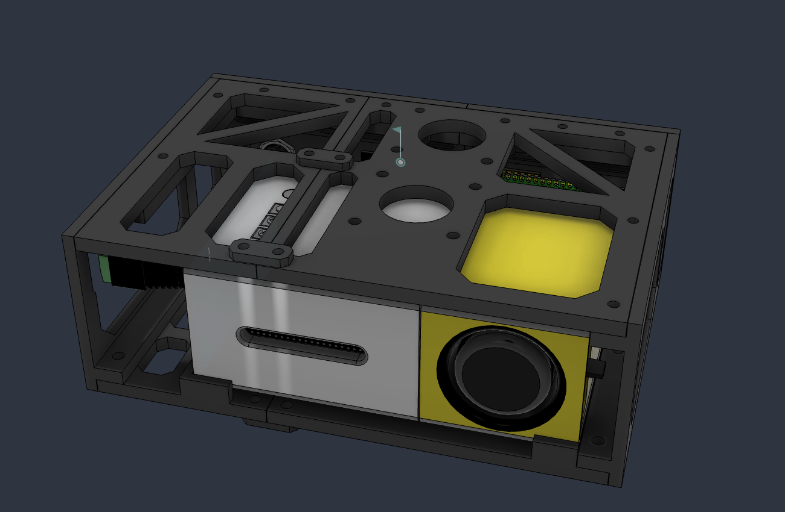
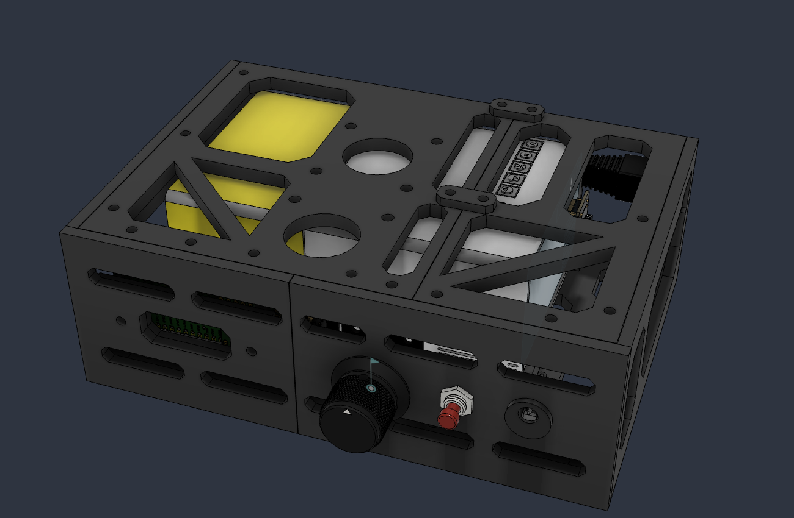
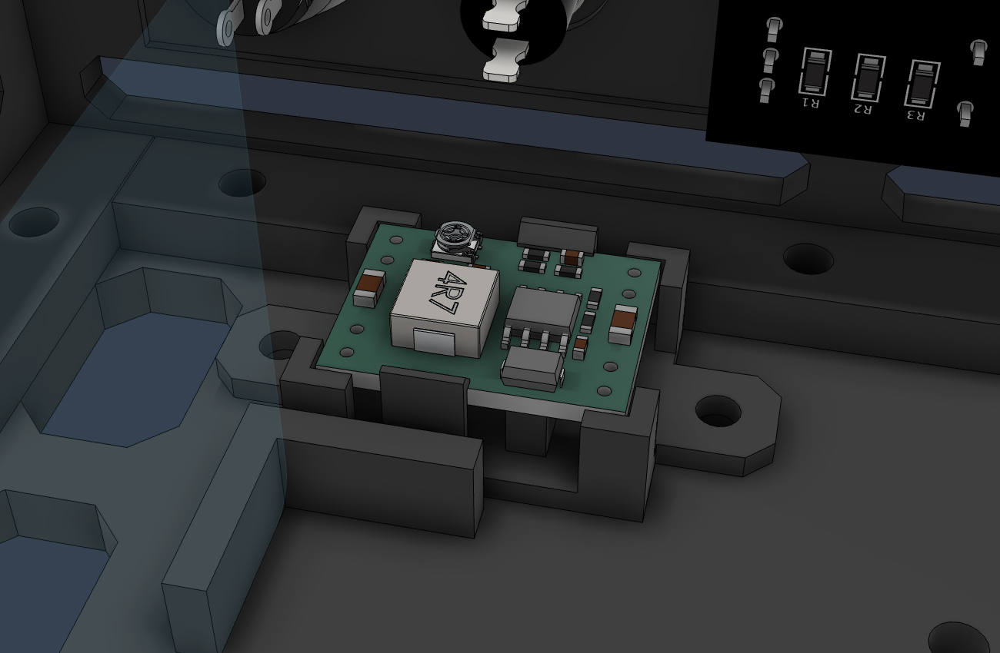

# Komorebi box cage: working notes

State and decisions for the printed open cage around the YG300 projector, the Pico and the controls.

The design rules are in [DESIGN_LANGUAGE.md](DESIGN_LANGUAGE.md). This file tracks what goes in, what is decided, and where the work stands.

Fusion files, in the project `AA`, folder `smartProjector / prototyping`:

- **`komorebi-box`:** the assembly. It links every bought part and the cage.
- **`komorebi-cage`:** the printed parts only. Built by [cad/build_cage.py](cad/build_cage.py).





More views are in [assets](assets): the underside with the seam straps and the two modules, the top, the bay without the top plate, the port end with the DC plug, the buck converter in its snap tray.

---

## Steps

1. [x] **Read `komorebi-box` and measure the parts.** Done `2026-11-23`.
2. [x] **Decide the layout.** Done `2026-11-23`, with Saurabh: rear bay, with a top plate.
3. [x] **Rough cage, parts placed on it.** Done `2026-11-23`.
4. [x] **First review by Saurabh.** Done `2026-11-23`, see [Review, first round](#review-first-round).
5. [x] **Fastener holes cut, fasteners counted.** Done `2026-11-23`.
6. [x] **Second review: PLA, brim, split parts.** Done `2026-11-23`, see [Review, second round](#review-second-round). The fastener list changed with it, see [Fasteners](#fasteners).
7. [ ] **Fastener models placed.** Saurabh brings one model of each kind into `komorebi-box`. They get copied and placed from [cad/fasteners.json](cad/fasteners.json).
8. [ ] **Sizes against the real projector**, then the lips.
9. [ ] **Test prints**, then the assembly notes.

---

## Rules for this cage

From Saurabh on `2026-11-23`:

- **No case around it.** The cage is the enclosure, and it is open so the projector can breathe.
- **The lens looks out of the front.** The DC socket, the rotary encoder and the button sit on the opposite side.
- **The Pico and the DVI sock are one rigid block.** They are soldered pin to pin.
- **The two CY HDMI plugs and their ribbon are reused.** The ribbon is 30 cm or longer and is not modelled.
- **Wires are not planned yet.** Not between button, converter, encoder and light sensor either.
- **The light sensor has its own module.** It fits on the bottom or on the top.
- **The magic arm adapter fits on the bottom or on the top too.** The cage stands on a tripod or hangs from a ceiling. Its thread is printed and tested, it must point away from the cage.
- **Saurabh brings the fastener models in.** The holes get designed, the fasteners get counted, then the models get copied and placed.
- **Every part prints on the Prusa Mini bed,** 180 x 180 mm, with room for a brim around it.
- **It is printed in PLA, with a brim.** Without a brim the edges curl up.
- **The rear, the top and the floor are two parts each.** Small parts stay flat. The joint between the two is small but strong.
- **No chamfer on an edge that lies on the bed.**
- **Enough room, not too much.** Tighter than the solar server cage.
- **The look follows Doscher.** Open trusses, octagon windows, screws that show.
- **No assembly documents yet.** Design first.

---

## Numbers

All in mm, in the coordinates of `komorebi-box`: Y is up, the lens face is +Z, the projector's ports are on the -X end. The same numbers are the `P` table at the top of [cad/build_cage.py](cad/build_cage.py).

```json
{
  "projector": {
    "x": [-86.1, 39.9],
    "y": [3.8, 50.8],
    "z": [-43.8, 36.2],
    "feet_bottom_y": 1.8,
    "own_tripod_thread": [-32.3, 20.3]
  },
  "cage": {
    "inner_x": [-120.1, 50.4],
    "inner_z_rear": -80.0,
    "front_edge_z": 40.0,
    "floor_top_y": 1.8,
    "top_plate_bottom_y": 52.8,
    "outside": [178.5, 61.0, 124.0]
  },
  "gaps": {
    "port_end": 34.0,
    "lever_end": 10.5,
    "rear_bay": 36.2,
    "above_projector": 2.0,
    "lens_face_to_front_edge": 3.8
  },
  "thickness": {
    "plates": 5.0,
    "frame_web": 4.0,
    "flange": 5.0,
    "control_field": 3.0,
    "at_button": 2.0
  },
  "module_port": {
    "opening_d": 24.0,
    "hole_square": 31.82,
    "tripod_port": [-23.1, -8.0],
    "sensor_port": [-23.1, -58.0]
  },
  "controls": {
    "height_y": 27.3,
    "jack_x": -98.0,
    "button_x": -76.0,
    "encoder_x": -50.0
  },
  "seams": {
    "plates_x": -60.0,
    "rear_frame_x": -23.1,
    "gap": 0.2,
    "strap_screws_from_seam": 5.5,
    "strap_z_floor": [35.5, -4.0],
    "strap_z_top": [35.5, -26.0]
  },
  "holes": {
    "m3_insert": 4.0,
    "m3_clearance": 3.4,
    "m2_insert": 3.2
  }
}
```

> [!Important]
> **The projector model is 126 x 80 x 47.** Shop listings give 126 x 86 x 47.6 for the YG300. The depth may be 6 mm short in the model, or the listing counts the lens ring. The cage takes both: the bay still has 30 mm then. The lips on the floor do not. They wait for a measurement of the real projector.

---

## What goes inside

Sizes are measured in `komorebi-box`. Use `root.allOccurrences` for that, see [Fusion traps](#fusion-traps).

| Part | Fusion file | Size | Where it sits | Held by |
| --- | --- | --- | --- | --- |
| Projector | `YG300 LCD Projector` | 126 x 47 x 80, feet 2 | On its feet on the floor plate, lens to +Z | Corner lips and the flange of the +X end frame, plus a 1/4 inch screw into its own tripod thread |
| Pico with DVI sock and HDMI plug | `PiPico2AndDVISock` | 74.3 x 22.9 x 16.1 | Upright on the rear frame, parts toward the projector, USB toward the +X end | `Pico holder: base`, four posts, four M2 screws |
| HDMI plug at the projector | `HDMI-CY-17-UP` | 16.2 x 14.5, sticks out 9 | In the projector's port on the -X end | The port |
| Second HDMI plug | `HDMI-CY-17-DN` | same | Not used, switched off in the browser | Nothing |
| DC plug adapter | `Male DC-Power-to-Screw-Terminals-Adapter-AP214` | 41 long, 30 of it outside the jack, 12.2 x 14 | In the projector's round jack on the -X end | The jack |
| Rotary encoder with knob | `RotaryEncoderAndGuiterMetalKnob` | knob 25 across, 19.5 high | Rear frame, pins toward the Pico | Its own nut, 7.2 hole |
| Button | `Switch Assembly` | 9.6 x 27 | Rear frame | Its own nut, 7.2 hole, panel 2 thick there |
| DC socket | `Socket Panel (1)` | 21 across the nut | Rear frame, toward the -X end | Its own nut, 11.2 hole |
| Buck converter | `DC-DC 4.5-28V to 0.8-20V Output 3A MP1584EN Step Down Buck Converter` | 22.4 x 17.1 x 4.6 | On the bay floor, lifted 5 | `Buck converter holder: tray`, snap fit |
| Light sensor | `BH1750` | flange 28 across, dome 25.5 | In its module, now on the floor, dome down | `Light sensor module: plate` |
| Tripod adapter | `Bottom Adapter for Magic Arm Nut` | 60 x 60 x 10 | On the floor's tripod port, turned 45 degrees | Four M3 from outside |

The models say `Raspberry_Pi_Pico_W` and `Adafruit DVI Sock`. The real boards are the Pico 2 W and the pi3g sock. Same footprint.

---

## Printed parts

In `komorebi-cage`. Every part lies flat on the bed and needs no supports. The largest is 120 x 120, so a 5 mm brim fits everywhere.

| Part | Component | Copies | Size | What it is |
| --- | --- | --- | --- | --- |
| Floor plate | `Cage: floor plate` | 1 | 110.1 x 119.8 x 12 | The +X part, 5 thick. The +X feet stand on it. Both module ports, the hole for the 1/4 inch screw, three corner lips |
| Floor plate, port | `Cage: floor plate, port` | 1 | 59.8 x 119.8 x 12 | The -X part. The -X feet stand on it. Carries the buck tray and the two -X corner lips |
| Top plate | `Cage: top plate` | 1 | 110.1 x 119.8 x 5 | The +X part. Both module ports, the window over the lens end, one truss window |
| Top plate, port | `Cage: top plate, port` | 1 | 59.8 x 119.8 x 5 | The -X part. Windows over the port bay and over the projector's buttons, one truss window |
| End frame | `Cage: end frame` | 1 | 120 x 61 x 14 | The +X end. Web 4 thick with a bay window and a projector window, a flange at the bottom and at the top. Its bottom flange is the projector's end stop |
| End frame, port | `Cage: end frame, port` | 1 | 120 x 61 x 14 | The -X end. Same, but the top flange stops before the DC plug and the window steps up in front of it |
| Rear frame | `Cage: rear frame` | 1 | 77.4 x 61 x 17 | The +X part, behind the Pico. Window behind the Pico, two holes for the Pico holder |
| Rear frame, port | `Cage: rear frame, port` | 1 | 100.9 x 61 x 17 | The -X part, with the knob, the button and the DC socket |
| Seam strap | `Cage: seam strap` | 4 | 19 x 8 x 3 | Flat bar with two holes across the plate seam, on the outside. Two on the floor, two on the top |
| Pico holder | `Pico holder: base` | 1 | 61.5 x 24 x 7.9 | Plate on the inside of the rear frame. Four posts with M2 inserts, two bosses with M3 inserts |
| Buck tray | `Buck converter holder: tray` | 1 | 43.4 x 21.1 x 10.2 | Snap tray, see [Buck tray](#buck-tray) |
| Sensor module | `Light sensor module: plate` | 1 | 44 x 44 x 4 | Plate with the dome hole and a seat for the sensor's flange |

How it is built:

- **Two plates and three upright frames make the box.** The front stays open.
- **A frame is a web with two flanges.** The flanges lie on the inside of the plates and carry the heat-set inserts. The screws go in from outside through the plates. So the plates stay plain, and every screw head shows.
- **The plates sit inside the frames.** The webs cover their edges.
- **The projector is not centred.** The -X end has 34 mm: the HDMI plug, the DC plug adapter with its 30 mm, and the folded ribbon. The +X end has 10.5 mm, enough for a finger on the focus lever through the window.
- **The rear bay is 36 mm deep.** Controls and Pico share the rear frame side by side, so air stays between the Pico and the projector's back vents: 14 mm at the HDMI plug, 24 mm along the board.
- **The control field is thinned to 3 mm on the inside,** 2 mm at the button. The models of the socket and the encoder are drawn for a 3.2 panel, and the button thread is short.
- **The knob sits on a mullion of the slot rows.** The rear seam sits on another one.
- **The bay window of the +X end frame is where a USB cable reaches the Pico.**
- **The floor is closed where the feet stand.** The feet are 14.8 square at the four corners.
- **All outer edges are square.** With a brim, a chamfer on the bed face would print onto the brim.

### Seams

The plates are cut at X -60, the rear frame at X -23.1. The two seams are 37 mm apart on purpose.

- **Each part bridges the other's seam.** The -X rear frame has flange screws left and right of the plate seam, at X -66 and X -52. The +X plates have flange screws left and right of the rear seam, at X -39 and X -7. No extra part is needed at the back.
- **The plate seam gets two straps per plate,** at the front edge and in the middle. A strap lies on the outside, its two M3 x 8 go into inserts in the plates.
- **The plate seam runs between the projector's -X feet and the module ports.** So each foot pair stands on one part, both ports are in one part, and no module covers a strap.
- **The rear seam runs between the knob and the Pico.** It cuts no hole and no window.
- **The two rear screws of the bay port go into the rear flange.** The flange has a tab there. With a module on the port, the module's own screws do that job. Without one, a plain M3 x 8 goes in. So the rear frame is screwed down right next to its seam on both plates.


### Module ports

A port is a 24 mm opening with four M3 holes on a 31.82 mm square. That is the hole pattern of the magic arm adapter, turned 45 degrees.

- **Both plates have the same two ports,** at the same place: one under the projector, one in the bay.
- **Both modules fit both ports.** So the tripod adapter and the light sensor each go on the bottom or on the top.
- **The sensor's flange is trapped** between its module plate and the cage plate. The dome looks out, the connector reaches through the opening into the bay.
- **The sensor belongs on the bay port.** On the other port its connector would hit the projector.
- **The bay port has two inserts in the plate and two in the rear flange.** A module there needs two M3 x 8 and two M3 x 12.

### Buck tray

The board has no mounting holes. Its six holes are solder pads for the wires, three on each short end.

- **The board drops between four corner posts onto two rails.** The rails keep it 5 mm above the tray, so solder joints and wire ends have room under the pads.
- **Two snap arms hook over the long edges,** 0.6 mm each. The arms are 6.7 mm long, so they bend without breaking.
- **Each arm is set off to one side.** The trimmer sits 0.4 mm from one long edge, the diode 0.7 mm from the other. The hooks land where the edge is free.
- **The short ends stay open** for the wires. The posts end at the top of the board.
- **Two ears with one M3 each hold the tray on the floor.**



---

## Fasteners

The holes are in the model. The list is written by the build script into [cad/fasteners.json](cad/fasteners.json): one row per fastener with its seat point and the direction it goes in.

| Fastener | Count | Where |
| --- | --- | --- |
| **M3 heat-set insert**, 4.0 hole | 49 | 25 in the frame flanges, 12 in the four module ports, 8 in the plates for the seam straps, 2 in the Pico holder, 2 in the floor for the buck tray |
| **M3 x 8**, cap head | 35 | 23 plate to frame, 8 seam straps, 2 sensor module, 2 Pico holder |
| **M3 x 12**, cap head | 2 | Sensor module, through the plate into the rear flange |
| **M3 x 6**, cap head | 6 | 4 tripod adapter, 2 buck tray |
| **M2 heat-set insert**, 3.2 hole | 4 | Pico holder posts |
| **M2 x 5** | 4 | Pico and DVI sock onto the posts |
| **1/4-20 x 10**, camera screw | 1 | Through the floor into the projector's own tripod thread |

That is 101 in all. Models to bring into `komorebi-box`, one of each: the M3 insert, M3 x 8, M3 x 12, M3 x 6, the M2 insert, M2 x 5, the 1/4 inch screw.

Where the 25 frame screws are:

| Joint | Floor | Top |
| --- | --- | --- |
| End frame, +X | 3 | 3 |
| End frame, port | 3 | 2 |
| Rear frame, +X part | 3 | 3 |
| Rear frame, port part | 4 | 4 |

- **The port end frame has one screw less on top.** Its top flange stops at Z 12 to clear the DC plug.
- **Two of the rear screws on each plate are the rear holes of the bay port.** On the floor the sensor module sits there, so those two are its M3 x 12. On the top they are plain M3 x 8.
- **No countersinks.** The cap heads stand proud, as on the solar server cage.
- **Not counted:** the nuts of the encoder, the button and the socket, and the tripod bushing in the magic arm adapter.

> [!Note]
> **The M2 insert hole is a start value.** 3.2 mm fits the common M2 x 3 inserts. Tell the size of the ones bought and the posts follow.

---

## Review, first round

Saurabh on `2026-11-23`, after the rough cage:

- **How is the buck converter held, snap fit? Its holes are for wires.** It was only located. Now it is a snap tray, see [Buck tray](#buck-tray).
- **Not enough room for the DC jack.** He added the DC plug adapter to `komorebi-box`. The -X end went from 17 to 34 mm, the +X end from 17 to 10.5 mm. The cage grew 10.5 mm in length.
- **Encoder a bit to the right, seen from behind.** It moved 5 mm and now sits on the mullion between two slots. Button and socket moved with it.
- **Check it against the Doscher images.** Done: truss windows in the floor, chamfered outer edges and rear corners, a window behind the Pico, screws that show on both plates and on the rear frame. *The edge chamfers went again in the second round.*
- **Then the fasteners:** edit the design, count, he brings the models.

---

## Review, second round

Saurabh on `2026-11-23`, after the fastener holes:

- **Do the faces fit the safe bed size?** His PrusaSlicer profile for the Mini: bed 180 x 180, one skirt loop 2 mm out, no brim, elephant foot compensation 0.2. The plates were 170.1 long and the rear frame 178.5. The rear frame did not fit safely.
- **The edge chamfers are useless, and the frames can only lie on their outer face.** He is right. A 45 degree chamfer on the bed face does print, but it does no job here: the slicer already takes care of the first layer. The 3 mm ones on the rear corners hung over the bed for three quarters of the wall.
- **It is printed in PLA, not ASA, and with a brim.** With a brim a chamfer on the bed face is worse: its second layer prints onto the brim. All edge chamfers are gone.
- **Rear, top and floor get split in two,** with a small but strong joint. Done, see [Seams](#seams).

---

## Checks

Done on `2026-11-23` in `komorebi-box` with the interference tool, hidden parts left out.

- **No part cuts into another.** Three touches stay, all between bought models: the socket's flange on the panel (under 0.1 mm), the HDMI plug inside the projector's port, the DC plug's barrel inside the projector's jack.
- **Every printed part is inside 120 x 120.** With a 5 mm brim that is 130 x 130 on the 180 x 180 bed.
- **The projector's buttons, focus lever, ports and vents are all open.**

---

## Open points

- [ ] **Real size of the projector,** width, depth, height, and how far the lens ring stands out.
- [ ] **Lips or loose stops.** The lips are printed onto the floor. Loose stops with slots would follow the real projector without a new floor.
- [ ] **PLA next to the projector's vents.** PLA gets soft at 55 to 60 degrees. The rear frame and the floor are 14 to 36 mm from the vents. Fine with the stock LED as far as we know, not checked with the brighter LED. PETG is the fallback.
- [ ] **Which plug goes into the projector.** `HDMI-CY-17-UP` is plugged in now. Both CY models are 10.5 wide, which is mini HDMI size.
- [ ] **Snap hooks against the real board.** The hook places come from the model's trimmer and diode.
- [ ] **Size of the M2 inserts.**

---

## Fusion traps

> [!Warning]
> **Run the build script only in the cage's own tab.** `komorebi-box` keeps its own copies of `komorebi-cage` open. `documents.item(i).activate()` can land on one of them. A change made there shows in the assembly but is never saved. The cage's own tab is the one where `isUpToDate` does not raise. The script checks that now. After the save, get the latest version in `komorebi-box`.

- **Measure nested parts with `root.allOccurrences`.** Walking `occurrence.childOccurrences` gives boxes in the wrong frame. It made the buck converter look flat when it stood on edge.
- **Run the interference tool in small groups.** All bodies in one call gave no result at all. One bought part against the cage and the projector works.
- **A camera set by script keeps perspective.** The zoom is the distance from eye to target, `viewExtents` is ignored. About 45 cm shows the whole cage.
- **The cage parts are plain bodies in base features.** The script builds them from boxes and cylinders and swaps the body in place, so the links stay valid. They have no sketches. A part Saurabh wants to edit by hand gets rebuilt with sketches then.
- **Hiding a cage part from `komorebi-box` marks that copy of the cage as changed.** Fusion may ask to save it on closing. Discard it.

---

## Log

### 2026-11-23

- Read `komorebi-box` version 15. Eleven linked parts, no joints.
- Asked four things. Answers: rear bay with a top plate, the sensor and the tripod adapter as modules for top or bottom, ribbon 30 cm or longer, nothing missing.
- New Fusion file `komorebi-cage`, hybrid design. Rough cage saved as version 3, linked into `komorebi-box` version 17.
- Found on the way: the second `HDMI-CY-17-UP` was parked beside the projector, not plugged in. The buck converter stood on edge. Both are placed now.
- First review by Saurabh, see [Review, first round](#review-first-round). He added the DC plug adapter, `komorebi-box` version 19.
- Second build: port bay 34 mm, snap tray, encoder on the mullion, Doscher pass, fastener holes. The two end frames are two components now. `komorebi-cage` version 6, `komorebi-box` version 20.
- The Amazon page of the buck converter could not be opened from the agent's side. The tray follows Saurabh's note and the model: six pads, no mounting holes.
- Second review by Saurabh, see [Review, second round](#review-second-round). Third build: floor, top and rear frame cut in two, four seam straps, edge chamfers removed, the buck tray moved 8 mm toward -X to stay on one plate. 101 fasteners. `komorebi-cage` version 7, `komorebi-box` version 21.
